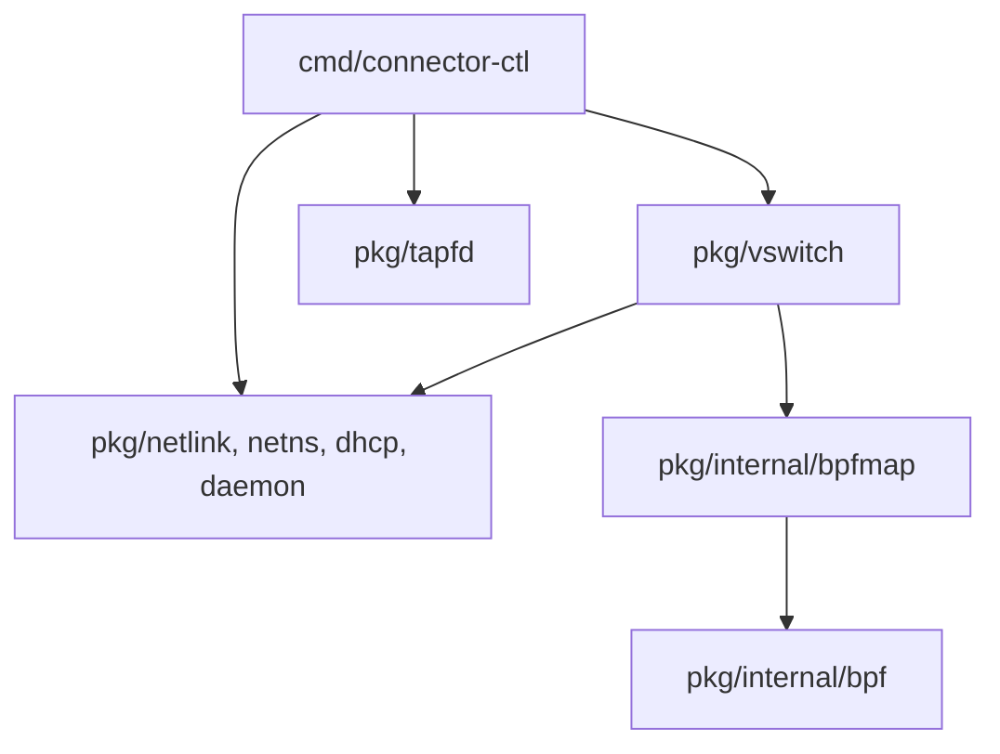

[English](CONTRIBUTING.md) | [简体中文](CONTRIBUTING_zh.md)

# Contributing to Connector


Thank you for contributing to `kuasar-sandbox/connector`.

## Contribution workflow

Use a public Fork and a topic branch. Contributors can open issues, review changes
and propose PRs without upstream write access. Maintainers review changes, arrange
trusted validation and squash merge; direct pushes to upstream `main` are not the
contribution path.

## Prepare a Fork

Fork the repository to your GitHub account, then configure HTTPS remotes:

```bash
git clone https://github.com/<your-login>/connector.git
cd connector
git remote add upstream https://github.com/kuasar-sandbox/connector.git
git fetch upstream
git switch -c feat/short-description upstream/main
# edit, test, and commit
git push -u origin feat/short-description
```

For a maintenance fix, start from the supported `upstream/release/vMAJOR.MINOR.x`
branch instead and target that branch in the PR. Enable **Allow edits from
maintainers** when appropriate.

To advance your Fork's `main` without overwriting local commits or uncommitted work:

```bash
git fetch upstream
git switch main
git merge --ff-only upstream/main
git push origin main
```

Commit or safely preserve uncommitted work before switching. If `--ff-only`
refuses because histories diverged, inspect the local commits and resolve the
history deliberately; do not reset or force-push the Fork's main branch as a
routine synchronization step. Create each new topic branch from the freshly
fetched upstream target, not from an unrelated feature branch.

## Pull request requirements

A pull request should:

- have a focused scope and a clear description of the problem and solution;
- link the relevant issue when one exists;
- include or update tests and documentation when behavior changes;
- contain no credentials, private keys, tokens, customer data, or unrelated generated files;
- describe validation already performed and any operational or compatibility risk.

Draft pull requests are welcome for early feedback, but they are not merge candidates.

## E2E execution requirements

Every `test/e2e/cases/<suite>.<case>.sh` starts with one static
`# e2e-requires: [...]` JSON array below its shebang. The owner format is
`test/e2e/lib/requirements.json` with `{"schema":1}`. Declare the minimum kernel
and service capabilities used by the case and its helpers; use `[]` explicitly
when none are needed. Missing, duplicate or unknown capabilities fail validation.
Normal pinned source selection discovers additions, removals and requirement
changes without a platform case allowlist. Runner labels and placement belong
to the trusted platform configuration, not cases. See the
[capability contract](https://github.com/kuasar-sandbox/kuasar-sandbox/blob/main/test/README.md#static-execution-requirements)
for supported names, checks and historical-input compatibility.

## Documentation

Follow the [project documentation policy](https://github.com/kuasar-sandbox/kuasar-sandbox/blob/main/CONTRIBUTING.md#documentation-contributions). Maintain full English/Chinese pairs at `name.md` and `name_zh.md` with reciprocal selectors. Preserve requirements, identifiers, examples, diagrams, facts and links; record source-backed corrections. Existing complete English-only material may remain English-only. A summary or language-detector pass is not a complete translation.


The three maintained topics have explicit ownership: `vswitch-operations.md` owns operator workflows, CLI/configuration and failure recovery; `vswitch.md` owns forwarding, identity, isolation, concurrency and ABI; `tapfd.md` owns the independent provider/consumer wire contract. Source/build/test procedures belong here or beside their executor. Add a new page only for a distinct task or independently consumed contract, not for each package or implementation mechanism.

## Licensing of contributions

By submitting a contribution, you agree that it is licensed under the license
that applies to the files being changed. New project files without a different
explicit license declaration are contributed under the
[Apache License 2.0](LICENSE). The repository's non-Apache boundaries are
documented in [LICENSE_SCOPE.md](LICENSE_SCOPE.md).

Only submit work that you have the right to contribute. Preserve applicable
copyright, attribution, NOTICE, and SPDX declarations when modifying
third-party or differently licensed material.

## CI and merge policy

The membership lookup checks the PR author, not the maintainer who reruns a job.
A rerun does not admit a non-member author. Use the central
[maintainer reception procedure](https://github.com/kuasar-sandbox/kuasar-sandbox/blob/main/CONTRIBUTING.md#ci-eligibility-and-external-contributions)
to preserve attribution and validate an adopted candidate. Updated source commits
require fresh inspection and CI; prior reception does not cover new changes.

The repository's trusted default-branch wrapper handles pull-request events;
candidate workflow files never decide admission or obtain control-plane secrets.
The [central CI contract](https://github.com/kuasar-sandbox/kuasar-sandbox/blob/main/docs/ci.md)
owns the current workflow entry points, exact status names, companion declaration
syntax, source selection and executable evidence checks. Do not copy those
identifiers into another independently maintained workflow guide.

All contributors may submit public Fork PRs. Access to a privileged integration
runner is a separate trust decision, not a condition for opening an issue or PR.
Automatic candidate execution accepts non-draft same-repository PRs and Fork PRs
whose author is an active organization member; it does not run arbitrary external
Fork code with organization credentials. For other contributors, a maintainer
reviews the change and may prepare a trusted upstream candidate PR, preserving
commit authorship, linking the original discussion and recording the source and
reviewed diff. The trusted candidate receives the normal tests and review. Do not
change membership, weaken admission or execute unreviewed Fork code merely to get
a check result. Drafts defer integration execution and are not merge candidates.

Before normal squash merge, verify all of the following against live GitHub state:

1. The PR is open and ready, targets `main` or a supported
   `release/vMAJOR.MINOR.x`, and all blocking review conversations are resolved.
2. The admitted integration commit has exactly the current target base and
   reviewed head as its ordered parents. The successful exact-integration status
   belongs to that commit, not merely to the PR head or an old run.
3. The linked trusted run completed the required tests; a skipped, cancelled or
   failed execution is not successful evidence. Its resolved control and execution
   workflows, source set and result must agree with the central CI contract.
4. Each declared companion was independently admitted and tested. Its repository,
   PR, base, head, target ref and integration commit still match the recorded set.
   A primary PR's success never substitutes for a companion's own required check.
5. Base/head changes, companion changes or edits to the companion declaration
   invalidate prior evidence. Produce a fresh supported PR event and verify the
   new result. Body edits alone do not trigger validation; mark Draft and then
   Ready again when a new event is needed without a new commit.

A rerun of an existing event is appropriate only for a diagnosed transient failure
when its admitted base, head, integration and companion inputs remain unchanged.
Do not add a manual-dispatch entry, manufacture a successful status or bypass
branch protection. Recheck the current source set immediately before merging.
After one companion merges, remove its obsolete declaration from the remaining
PRs and rerun against the selected target-line sources.

Candidate execution must not retain the source-fetch App token or inherit release
write credentials. Keep execution and control identities, caches and workspaces
within their documented trust boundaries. Auto-merge, merge commits and rebase
merges are not used; maintainers perform the normal reviewed squash merge.

## Review expectations

Be constructive and specific. Authors should resolve review conversations or explain why a requested change is not applicable. Maintainers may close stale, superseded, unsafe, or out-of-scope pull requests with an explanation.

<a id="build-and-validation"></a>
## Build and validation

Local builds use environment-provided Go and inherit its `GOROOT` and `GOTOOLCHAIN`
selection. CI builds and packages on native x86_64/aarch64 runners with one
admitted, immutable Workbench image identity per architecture. Release builds,
ordinary tests and packaging use build mode with an ordinary UID and private
writable paths. The complete `bash scripts/ci-source-checks.sh` gate runs in
Workbench system mode, retaining unit tests, race instrumentation, vet and real
BPF checks with `REQUIRE_CONNECTOR_STATS=1`; missing kernel capabilities fail the
gate. Release orchestration requires environment-provided `gh` with `api --slurp`;
credentials remain outside
the Workbench source environment.

```bash
make build                      # bin/<arch>/connector-ctl, with a native-arch bin/ symlink
make build TARGET_ARCH=aarch64  # Pure-Go cross-build; amd64/arm64 aliases are also accepted
make release VERSION=vX.Y.Z     # Package and validate build/release-bundle
make generate                   # Regenerate changed BPF source; clang 12+ (prebuilt .o files are tracked)
make test-source-checks          # race, real pinned-BPF stats and vet; requires sudo
make test                       # Unit tests
sudo make test-integration      # Integration: root and a BPF-capable kernel
sudo make bench                 # Benchmarks: root and iperf3
make lint                       # go vet
make fmt                        # Go formatting and clang-format
make vmlinux                    # Regenerate bpf/vmlinux.h; requires bpftool
```

Go 1.26.1+ is required for source builds. Clang/LLVM 12+ is needed only when regenerating the tracked BPF objects. A skipped privileged test is not completed network validation. Run privileged tests in an isolated candidate environment and clean up every TAP, namespace, route, rule, BPF map and pin path owned by the run. Product E2E uses the [prepared platform network suite](docs/vswitch-operations.md#prepared-platform-validation).

## Tests

### Layers

| Layer | Files | Privilege | Coverage |
|---|---|---|---|
| Unit | `*_test.go`. | Ordinary user. | Pure logic with injected BPF/netlink dependencies. |
| Integration | `*_integration_test.go`. | Root/BPF-capable kernel. | Real BPF loads/netlink with integration build tags and privileged execution. |
| End-to-end | [test/e2e/cases](test/e2e/cases) `network.*.sh`. | Root. | Real topology/packets; the prepared platform runner executes each case with owned setup and cleanup. |
| Benchmarks | [perf_bench.sh](examples/perf_bench.sh), [start_perf_bench.sh](examples/start_perf_bench.sh). | Root and iperf3. | Throughput/PPS/RTT at varying port counts and control-plane startup timing. |

### Three levels of BPF validation

1. **Layout:** integration tests under pkg/internal/bpf verify Go/C offsets, sizes and alignment.
2. **BPF_PROG_TEST_RUN:** construct packets, execute the program and assert actions/output bytes. Where ingress_ifindex cannot be supplied conveniently, tests map ifindex=0 to the test slot for tc_ingress_nx.
3. **Real topology:** `test/e2e/cases/network.*.sh` cases create networks and use actual ping/iperf traffic.

`TestNativeStatsRealResetReuseAndReadOnlyFailure` uses actual pinned locked BPF maps and an independently opened reader, including a kernel-enforced read-only FD to prove reset failure. `TestNativeStatsRealConcurrentOwnership` exercises shared reads against attach/detach. Other real kernel cases in that group cover force cleanup/replacement during a read, SIGKILL immediately after the ownership CAS, and the production BPF helper rejecting late TC writes while four execution streams race resets. Source integration CI runs these with `REQUIRE_CONNECTOR_STATS=1`, race detection and privileged execution; missing capability is a failure, not accepted skipped coverage. `network.management.sh` also keeps four actual FloatingIP UDP streams across 20 detach/attach cycles, requiring communication to resume and verifying asymmetric packet/byte pairs after each reuse.

### E2E suites

Prepare the platform release, then run `sudo test/e2e/e2e run --workdir /path/to/prepared --suite network` from its directory. Each case owns setup, assertions and cleanup; locator variants run inside `network.geneve-ip.sh`.

| Case file | Coverage |
|---|---|
| network.management.sh | Management connectivity, local sandbox isolation, actual FloatingIP service NAT and asymmetric UDP packet/byte direction and 20 slot reuses under four live streams via `stats_management.py`. |
| network.geneve-ethernet.sh | Legacy port locator with Ether-over-GENEVE through a Linux gateway bridge. |
| network.geneve-ip.sh | IP-over-GENEVE between switches; the case covers port/vni/tlv locators, bidirectional connectivity and transit counters. |
| network.provision.sh | Two-phase startup, Reserved-slot repair and show. |
| network.tap.sh | TAP mode, open-port, attach --open-port and mode changes. |
| network.vswitch-cleanup.sh | Missing switch namespace cleanup preserves unrelated host/peer interfaces and the MMDS bind address while removing stale BPF pins. |

For manual topology construction and lifecycle operations, use the maintained [vSwitch operations guide](docs/vswitch-operations.md). Consume the actual allocation returned by `attach`; do not infer a port from a sandbox index.

### Real statistics benchmark

The small `BenchmarkNativeTrafficStats` benchmark reads 1/16/64 attached ports from real pinned maps, reporting allocations and FD/goroutine deltas. Run it on a BPF-capable host; results are local measurements, with no machine-specific pass threshold:

```bash
GOWORK=off go test -tags=integration -exec 'sudo -n env REQUIRE_CONNECTOR_STATS=1' \
  -run '^$' -bench BenchmarkNativeTrafficStats -benchtime=300ms -count=3 ./pkg/vswitch
```

## Internal organization

| Path | Role |
|---|---|
| `cmd/connector-ctl/` | Cobra CLI, JSON output/dependency injection and the tapfd provider subcommand. |
| `pkg/tapfd/` | Public protocol reference: PortMetadata, OpenTap, SendFd, RecvFd, RecvFds, RecvFdsWithNetns, ConnectUnix and UnixConnFromFd. |
| `pkg/vswitch/` | Public lifecycle API: context/Open, lifecycle/Start/StartReserved, provision, stop, Attach/Detach/Reserve, Status/Stats, Config/FileConfig, metadata, flock and exported helpers. |
| `pkg/netlink/` | Public veth/TAP/TC and batched netlink operations. |
| `pkg/netns/` | Public namespace enter/move/exec. |
| `pkg/dhcp/` | Public embedded DHCP client/server. |
| `pkg/daemon/` | Public systemd sd_notify support. |
| `pkg/internal/bpf/` | Internal BPF ABI: generated cilium/ebpf bindings, types and loader. |
| `pkg/internal/bpfmap/` | Internal ABI-coupled mmap, CAS, counters and MAC derivation. |
| `bpf/` | C sources: switch_kern.c, common.h and vmlinux.h. |
| `test/e2e/` | Canonical network cases and low-level helpers for the prepared platform runner. |
| `examples/` | Operations/benchmark scripts and tapfd_receiver source example. |
| `dist/` | systemd service/configuration templates. |

Byte-offset BPF structure access belongs in pkg/internal; a field-offset change is an ABI change. Go's internal rule permits imports only from within the parent pkg tree, not from cmd or arbitrary external modules. The other pkg packages expose the intended public API. CLI code uses helpers re-exported by pkg/vswitch/exports.go and follows the same API path as external embedders.

Dependency direction is acyclic:



pkg/tapfd is self-contained apart from the standard library and golang.org/x/sys.

## Component packaging and releases

Preview lifecycle, eligibility and cleanup follow the [platform release contract](https://github.com/kuasar-sandbox/kuasar-sandbox/blob/main/docs/release.md). This section owns Connector-specific build and package inputs.

The selected owner source explicitly declares its compiled E2E helper inventory in `release/helper-inputs.json`. The current inventory is empty. Future helpers and their build recipe belong in this owner declaration; aggregate packaging discovers them without a platform filename list.

Build from the selected source with the component Makefile. `release.sh package`
uses the matching binaries in `bin/<arch>`, or an explicit `RELEASE_BIN_DIR`;
it collects materials and creates the bundle without rebuilding those binaries
or resetting source/build caches. Keep the selected source checkouts, dependency
versions and native build records together with the outputs.

Packaging records the actual Go versions and effective module replacements.
Go/module LICENSE and NOTICE files come from the selected compiler installation
and matching module sources, preserving nested paths. Module resolution uses the
normal Go cache and routing; downloaded module checksums must match the binaries.
An organization namespace alone does not exempt modules from notice collection.
This component has no internal sibling dependencies. Unsupported local replacements
need versioned module inputs for the official package.

Licenses and notices live under `share/licenses/<component>`. Collection fails on missing notices, unreadable subtrees or partial traversals. Package validation checks required files, payload identities and archive paths, types and modes. Downloads use native GitHub asset sizes and digests. New packages and Releases contain no source or historical test records, independent `SHA256SUMS`, or source/Preview markers. The publisher uses human release notes, checks the current build outputs, and refuses to replace existing assets with different bytes.

Validation requires the selected native Linux architecture (amd64 for x86_64,
arm64 for aarch64) for the
`github.com/kuasar-sandbox/connector/cmd/connector-ctl` main package and the
matching Connector module. Deployment files and operational helpers are copied
from the selected source tree. The archive retains the embedded eBPF source
and license identity, including the project license scope and GPL text.
Validation rejects unexpected payloads, unsafe paths, links, ownership or modes,
and materials outside the component namespace. License directories include the Connector project, its embedded eBPF, and the Go toolchain and versioned third-party Go dependencies used by `connector-ctl`.

`connector` publishes independent component versions named `vX.Y.Z`. Each published native-architecture component archive contains `connector-ctl`, deployment files, and the operational helpers selected by the component release contract. The aggregate platform archive carries selected user guides and canonical E2E runtime inputs from its explicit documentation/test selections. The selected guide includes the operations, network and TAPFD contracts; contributor instructions and source-only tests remain linked to the selected source revision.
Use `make release VERSION=vX.Y.Z` to build and validate the same local bundle layout.

The project repository publishes aggregate versions named `release-vX.Y.Z`, selecting an exact `connector` tag together with the other release units and validating the combined platform. Component and aggregate version numbers are independent.

See the [project release documentation](https://github.com/kuasar-sandbox/kuasar-sandbox/blob/main/docs/release.md) and the [latest Stable aggregate release](https://github.com/kuasar-sandbox/kuasar-sandbox/releases/latest).
