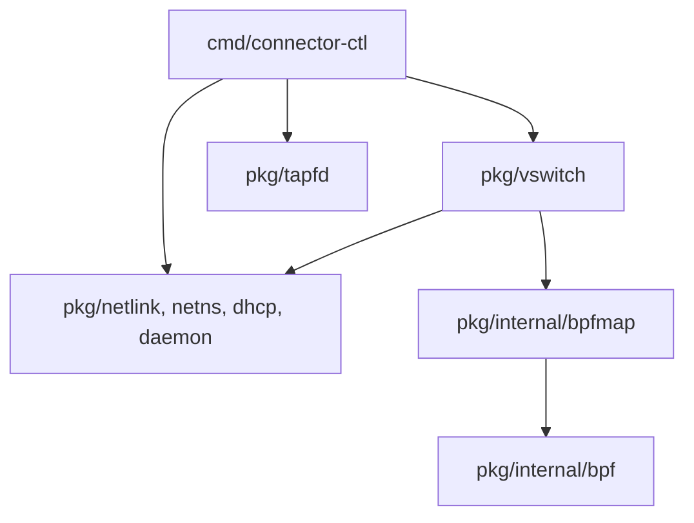

[English](CONTRIBUTING.md) | [简体中文](CONTRIBUTING_zh.md)

# 参与 Connector 开发


欢迎参与 `kuasar-sandbox/connector`。

## 贡献流程

使用公开 Fork 和主题分支。贡献者无需上游写权限即可提交 Issue、参与评审和提出 PR。维护者负责审查、安排可信验证并执行 squash merge；直接推送上游 `main` 不是贡献流程。

## 准备 Fork

将仓库 Fork 到自己的 GitHub 账户，并配置 HTTPS remote：

```bash
git clone https://github.com/<your-login>/connector.git
cd connector
git remote add upstream https://github.com/kuasar-sandbox/connector.git
git fetch upstream
git switch -c feat/short-description upstream/main
# 编辑、测试并提交
git push -u origin feat/short-description
```

维护修复应从受支持的 `upstream/release/vMAJOR.MINOR.x` 分支开始，并以该维护分支为 PR 目标。适用时启用 **Allow edits from maintainers**。

在不覆盖本地提交或未提交工作的前提下，同步 Fork 的 `main`：

```bash
git fetch upstream
git switch main
git merge --ff-only upstream/main
git push origin main
```

切换分支前先提交或安全保存未提交修改。若 `--ff-only` 因历史分叉而拒绝，检查本地提交并明确处理历史；不要将 reset 或强制推送 Fork 的主分支作为常规同步手段。每个新主题分支均应从刚获取的上游目标分支建立，而非无关的功能分支。

## Pull Request 要求

PR 应当：

- 保持范围集中，清楚说明问题与解决方式；
- 在存在相关 Issue 时建立链接；
- 行为变化时新增或更新相应测试与文档；
- 不包含凭据、私钥、令牌、客户数据或无关生成文件；
- 说明已完成的验证，以及运行或兼容风险。

欢迎通过 Draft PR 获取早期反馈，但 Draft 不属于可合并候选。

## E2E 执行要求

每个 `test/e2e/cases/<suite>.<case>.sh` 在 shebang 下必须有且只有一个静态 `# e2e-requires: [...]` JSON 数组。Owner 格式由 `test/e2e/lib/requirements.json` 的 `{"schema":1}` 声明。填写 case 及其 helper 实际使用的最小内核和服务能力；不需要时显式使用 `[]`。缺失、重复或未知能力会导致验证失败。

正常的固定源码选择自动发现 case 增删与能力变更，无需平台 case 白名单。Runner 标签与调度位置属于可信平台配置，不由 case 决定。支持名称、探测方式和历史输入兼容规则见[能力契约](https://github.com/kuasar-sandbox/kuasar-sandbox/blob/main/test/README_zh.md#静态执行需求)。

## 文档

遵循[项目文档规范](https://github.com/kuasar-sandbox/kuasar-sandbox/blob/main/CONTRIBUTING_zh.md#文档贡献)。维护 `name.md` 与 `name_zh.md` 的完整英中版本及互相可达的语言选择链接。保留要求、标识符、示例、图、事实与链接；对修正内容记录源码依据。已有完整的纯英文资料可以维持英文；摘要或语言检测通过不能替代完整翻译。


三个维护主题各有明确职责：`vswitch-operations_zh.md` 负责操作流程、CLI/配置与故障恢复；`vswitch_zh.md` 负责转发、身份、隔离、并发与 ABI；`tapfd_zh.md` 负责可独立实现的 provider/consumer wire 契约。源码、构建与测试流程放在本指南或相应执行器旁。仅为独立任务或独立消费的契约增页，不按 package 或实现机制逐项建文件。

## 贡献许可

提交贡献意味着同意适用被修改文件的许可。没有不同显式许可声明的新项目文件按 [Apache License 2.0](LICENSE) 贡献。本仓的非 Apache 边界见 [LICENSE_SCOPE_zh.md](LICENSE_SCOPE_zh.md)。

只提交自己有权贡献的内容。修改第三方或采用其他许可的资料时，保留适用的版权、署名、NOTICE 与 SPDX 声明。

## CI 与合并规则

成员资格检查针对 PR 作者，而非重新运行任务的维护者。重跑不会使非成员作者获得准入。采用[统一维护者接收流程](https://github.com/kuasar-sandbox/kuasar-sandbox/blob/main/CONTRIBUTING_zh.md#ci-准入与外部贡献)，保留署名并验证接收的候选。源码提交更新后必须重新检查和运行 CI；此前的接收不覆盖新增修改。

仓库可信默认分支中的 wrapper 处理 Pull Request 事件；候选工作流文件不能决定自身准入，也不能获取控制面秘密。[统一 CI 契约](https://github.com/kuasar-sandbox/kuasar-sandbox/blob/main/docs/ci_zh.md)定义当前工作流入口、精确状态名、companion 声明语法、源码选择与可执行证据检查。不要把这些标识复制到另一份独立维护的工作流指南。

所有贡献者均可提交公开 Fork PR。能否访问特权集成 Runner 是独立的信任判断，不是创建 Issue 或 PR 的前提。自动候选执行接受同仓非 Draft PR，以及作者为活跃组织成员的 Fork PR；不会使用组织凭据运行任意外部 Fork 代码。对其他贡献者，维护者先审查修改，再按需建立可信上游候选 PR，保留提交作者、链接原讨论，并记录源码与已审查差异。可信候选仍接受正常测试和评审。不得仅为取得检查结果而改变成员身份、放宽准入或执行未经审查的 Fork 代码。Draft 延后集成执行，不能作为合并候选。

正常 squash merge 前，必须依据 GitHub 实时状态确认：

1. PR 处于 open 和 ready 状态，目标为 `main` 或受支持的 `release/vMAJOR.MINOR.x`，所有阻塞评审讨论均已解决。
2. 获准集成提交的两个有序父提交精确对应当前 target base 与已审查 head。成功的精确集成状态必须属于这个提交，而非仅属于 PR head 或旧运行。
3. 关联的可信运行已完成所需测试；跳过、取消或失败不能当作成功证据。其解析出的控制/执行工作流、源码集合和结果必须符合统一 CI 契约。
4. 每个声明的 companion 均独立获准并经过测试。仓库、PR、base、head、target ref 和 integration commit 仍与记录集合一致。主 PR 成功不能替代 companion 自身的必需检查。
5. Base/head、companion 或 companion 声明变化会使旧证据失效。生成新的受支持 PR 事件，并验证新结果；仅修改正文不会触发验证。没有新提交但需要新事件时，先设为 Draft，再设回 Ready。

只有明确诊断为瞬态故障，且事件对应的 base、head、integration 和 companion 输入未变化时，才适合重跑已有事件。不要新增 manual-dispatch 入口、伪造成功状态或绕过分支保护。合并前再次检查当前源码集合。一个 companion 合并后，从其他 PR 中移除已过时的声明，并针对选定目标线源码重新运行。

候选执行不得保留源码获取 App token 或继承发行写凭据。执行与控制身份、缓存、工作空间应遵守各自信任边界。不使用 auto-merge、merge commit 或 rebase merge；维护者执行正常的已评审 squash merge。

## 评审预期

保持建设性并给出具体意见。作者应解决评审讨论，或解释建议为何不适用。维护者可以说明理由后关闭长期无进展、被替代、不安全或超出范围的 PR。

<a id="build-and-validation"></a>
## 构建与验证

本地构建使用环境提供的 Go, 并继承 `GOROOT`、`GOTOOLCHAIN` 等工具链选择.
CI 构建和打包使用原生 x86_64/aarch64 Runner, 每种架构在一次运行中固定一个已通过
验证的 Workbench 镜像身份. 发布构建、普通测试和打包在 build 模式中使用
ordinary UID 及任务私有可写路径. 完整的 `bash scripts/ci-source-checks.sh` 门禁
在 Workbench system 模式运行, 保留单元测试、race、vet 以及
`REQUIRE_CONNECTOR_STATS=1` 的真实 BPF 检查; 缺少内核能力时门禁失败.
发布编排由环境提供支持 `api --slurp` 的 `gh`, 凭据不进入
Workbench 源码执行环境.

```bash
make build                      # 产物: bin/<arch>/connector-ctl(并在 bin/ 建同名软链)
make build TARGET_ARCH=aarch64  # 交叉编译(纯 Go,无需交叉工具链);别名 amd64 / arm64
make release VERSION=vX.Y.Z     # 打包并校验 build/release-bundle
make generate                   # 仅修改 bpf/*.c 时需要(clang 12+);仓库自带预生成 .o
make test-source-checks          # race、真实 pinned-BPF 统计与 vet；需要 sudo
make test                       # 单元测试
sudo make test-integration      # 集成测试(root + BPF 内核)
sudo make bench                 # 性能基准(root + iperf3)
make lint                       # go vet
make fmt                        # Go formatting 与 clang-format
make vmlinux                    # 重新生成 bpf/vmlinux.h(需 bpftool)
```

源码构建需要 Go 1.26.1+；仅重新生成已跟踪 BPF 对象时需要 Clang/LLVM 12+。特权测试被跳过不等于网络验证完成。应在隔离候选环境运行特权测试，清理本次运行拥有的所有 TAP、namespace、route、rule、BPF map 与 pin path。产品 E2E 使用[已准备平台的网络 suite](docs/vswitch-operations_zh.md#已准备平台的网络验证)。

## 测试

### 分层

| 层 | 文件 | 权限 | 内容 |
| --- | --- | --- | --- |
| 单元 | `*_test.go` | 普通用户 | 纯逻辑;mock 注入 BPF/netlink |
| 集成 | `*_integration_test.go` | root | 真实 eBPF 加载、netlink 操作;`-tags=integration -exec sudo` |
| 端到端 | `test/e2e/cases/network.*.sh` | root | 完整网络拓扑 + 真实包；prepared 平台 runner 执行每个用例，由用例负责 setup 与 cleanup |
| 基准 | `examples/perf_bench.sh`、`examples/start_perf_bench.sh` | root + iperf3 | 数据面吞吐/PPS/RTT(不同端口密度)与控制面 Start 耗时 |

### eBPF 三层验证

1. **结构对齐** — `pkg/internal/bpf/*_integration_test.go` 校验 Go ↔ BPF C 结构内存
   布局(偏移、大小、对齐)。
2. **`BPF_PROG_TEST_RUN`** — 直接执行 eBPF 程序,喂入手工构造的报文,断言返回 action
   与输出字节。`BPF_PROG_TEST_RUN` 不易设置 `skb->ingress_ifindex`,对 `tc_ingress_nx`
   经 `ifindex=0 → slot_id` 的 map 项绕过。
3. **真实拓扑** — `test/e2e/cases/network.*.sh` 建立完整网络拓扑,用真实 ping/iperf 验证转发。

`TestNativeStatsRealResetReuseAndReadOnlyFailure` 使用真实 pinned locked BPF map 和独立打开的 reader,并通过内核强制只读的 FD 验证 reset 失败. `TestNativeStatsRealConcurrentOwnership` 覆盖共享读取与 attach/detach 并发. 其它同组真实内核用例覆盖读中 force cleanup/替换、owner CAS 后 SIGKILL,以及共用生产 BPF helper 的迟到 TC 写入和四路并发执行流与重置并发. 源码集成 CI 在 `REQUIRE_CONNECTOR_STATS=1`、race 和特权执行下运行这些用例;缺少能力会失败,不会把 skip 作为通过证据. `network.management.sh` 还以四条真实 FloatingIP UDP 流反复 detach/attach 20 次,逐次要求通信恢复并核验非对称包数/字节数关系.

### e2e 套件

准备平台发布包后，在其目录中运行 `sudo test/e2e/e2e run --workdir /path/to/prepared --suite network`。每个用例负责 setup、断言及 cleanup；locator 变体在 `network.geneve-ip.sh` 内执行。

| 用例文件 | 覆盖场景 |
| --- | --- |
| `network.management.sh` | 管理平面连通、沙箱间隔离、真实 FloatingIP service NAT,以及 `stats_management.py` 的非对称 UDP 包数/字节方向断言及四流并发下的 20 次 slot 重用 |
| `network.geneve-ethernet.sh` | legacy port locator 的 Ether-over-GENEVE 经 Linux gateway bridge |
| `network.geneve-ip.sh` | IP-over-GENEVE 双 switch,由该用例分别覆盖 port/vni/tlv locator、双向连通与 transit stats |
| `network.provision.sh` | 两阶段启动 + Reserved 修复 + show |
| `network.tap.sh` | tap 模式、open-port、`attach --open-port`、模式切换 |
| `network.vswitch-cleanup.sh` | switch namespace 缺失时，清理保留无关 host/peer 接口与 MMDS bind 地址，并移除旧 BPF pin |

手工搭建拓扑与生命周期操作统一见维护中的 [vSwitch 运维指南](docs/vswitch-operations_zh.md)。
使用 `attach` 返回的实际分配结果，不按沙箱索引推算端口。

### 真实统计基准

小型 `BenchmarkNativeTrafficStats` benchmark 从真实 pinned map 读取 1/16/64 个已 attach 端口,报告分配量和 FD/goroutine 增量. 在具备 BPF 能力的宿主运行;结果是本机测量值,不设置机器相关通过阈值:

```bash
GOWORK=off go test -tags=integration -exec 'sudo -n env REQUIRE_CONNECTOR_STATS=1' \
  -run '^$' -bench BenchmarkNativeTrafficStats -benchtime=300ms -count=3 ./pkg/vswitch
```

## 内部组织

| 路径 | 职责 |
|---|---|
| cmd/connector-ctl/ | Cobra CLI、JSON 输出/依赖注入,以及 tapfd provider 子命令。 |
| pkg/tapfd/ | 公开协议参考:PortMetadata、OpenTap、SendFd、RecvFd、RecvFds、RecvFdsWithNetns、ConnectUnix、UnixConnFromFd。 |
| pkg/vswitch/ | 公开生命周期 API:context/Open、lifecycle/Start/StartReserved、provision、stop、Attach/Detach/Reserve、Status/Stats、Config/FileConfig、metadata、flock 和 exports。 |
| pkg/netlink/ | 公开 veth/TAP/TC 与批量 netlink 操作。 |
| pkg/netns/ | 公开 namespace enter/move/exec。 |
| pkg/dhcp/ | 公开 DHCP 客户端/服务端。 |
| pkg/daemon/ | 公开 systemd sd_notify。 |
| pkg/internal/bpf/ | 内部 BPF ABI:生成的 cilium/ebpf 绑定、types 与 loader。 |
| pkg/internal/bpfmap/ | 内部 ABI 耦合的 mmap、CAS、stats 与 MAC 派生。 |
| bpf/ | switch_kern.c、common.h、vmlinux.h 等 C 源。 |
| test/e2e/ | 供 prepared 平台 runner 使用的规范 network 用例和底层 helper。 |
| examples/ | 运维/基准脚本与 tapfd_receiver 源码示例。 |
| dist/ | systemd 单元/配置模板。 |

直接按字节偏移访问 BPF 结构的代码属于 pkg/internal,字段偏移变动即 ABI 变更。
Go internal 规则只允许 parent pkg 树内的代码导入,不允许 cmd 或任意外部 module。
其余 pkg 包提供预期公开 API。CLI 经 pkg/vswitch/exports.go 重导出的 helper 调用,
与外部嵌入者走同一 API 路径。

依赖方向无环:



pkg/tapfd 除标准库与 golang.org/x/sys 外独立。

## 组件打包与发行

Preview 生命周期、资格判定与清理遵循[平台发行契约](https://github.com/kuasar-sandbox/kuasar-sandbox/blob/main/docs/release_zh.md)。本节维护 Connector 自身的构建与打包输入。

所选 owner 源码在 `release/helper-inputs.json` 显式声明编译型 E2E helper 清单。当前清单为空。后续 helper 及其构建配方由此 owner 声明维护，聚合打包自动发现，无需平台文件名清单。

使用组件 Makefile 从选定源码构建。`release.sh package` 使用匹配的
`bin/<arch>` 二进制,或显式指定的 `RELEASE_BIN_DIR`;只收集材料并生成 bundle,
不重新构建二进制,不重置源码或构建缓存。所选源码 checkout、依赖版本、原生
构建记录与产物应一并保留。

打包记录实际 Go 版本和生效的 module 替换。Go/module LICENSE、NOTICE 取自所选
编译器安装和匹配的 module 源码,保留嵌套路径。模块解析沿用正常 Go 缓存与路由,
下载模块的校验和须匹配二进制记录。组织命名空间本身不豁免模块的声明收集。
本组件没有内部兄弟组件依赖。官方包中不受支持的本地替换需要改用带版本的
module 输入。

许可证和声明放在 `share/licenses/<component>`。声明缺失、目录不可读或遍历不完整时收集失败。包验证检查必需文件、载荷身份及归档路径、类型和权限。下载使用 GitHub 原生资产大小和摘要。新包和 Release 不携带来源或历史测试记录、独立 `SHA256SUMS`、来源/Preview 标记。发布者使用人类说明，检查本次构建输出，并拒绝覆盖同名不同内容资产。

验证要求匹配所选原生 Linux 架构（x86_64 对应 amd64，aarch64 对应 arm64）的
`github.com/kuasar-sandbox/connector/cmd/connector-ctl` main package 及匹配的
Connector module。部署文件和运维辅助脚本取自所选源码树。归档保留内嵌 eBPF
的来源及许可标识,包括项目许可范围说明和 GPL 正文。验证拒绝额外载荷、不安全
路径、链接、错误属主或权限,以及组件命名空间以外的材料。
许可目录包含 Connector 项目、其内嵌 eBPF，以及 `connector-ctl` 使用的 Go 工具链和版本化第三方 Go 依赖。

`connector` 独立发布 `vX.Y.Z` 组件版本。已发布原生架构的组件归档包含 `connector-ctl`、部署文件和组件发行合同选定的运维辅助脚本。聚合 platform 包按显式文档/测试选择携带用户指南与规范 E2E 运行输入，选定 guide 包含操作、网络与 TAPFD 契约；贡献说明与源码专用测试链接到所选源码版本。用 `make release VERSION=vX.Y.Z` 构建并验证相同的本地 bundle 布局。

项目主仓独立发布 `release-vX.Y.Z` 聚合版本,选择精确的 Connector Tag 与其他发行单元,并验证组合后的平台。组件与聚合版本号相互独立。

参见[项目发行文档](https://github.com/kuasar-sandbox/kuasar-sandbox/blob/main/docs/release_zh.md)和[最新 Stable 聚合渠道](https://github.com/kuasar-sandbox/kuasar-sandbox/releases/latest)。
