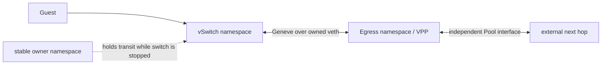

[English](egress.md) | [简体中文](egress_zh.md)

# Geneve Egress operations and control contract

Egress is an IPv4 Geneve gateway with ordered ACLs, DNAT, longest-prefix Pool selection and native NAT44-ED. Local and remote deployments use the same configuration and session API. It does not provide DNS/domain policy, an application proxy, IPv6 forwarding or automatic failover to another Pool. [Proposal #117](https://github.com/kuasar-sandbox/connector/issues/117) supersedes the former #9 proposal.

The control binary includes `egress`; its VPP runtime is a separate native build. Follow [build and acceptance](../egress/README.md) before deployment. Use the pinned runtime and its matching plugins together. Linux interfaces supplied to the gateway are dedicated to its dataplane: VPP owns their IPv4 addresses, while Linux keeps them administratively up without IPv4 addresses. The AF_PACKET backend disables and verifies checksum/segmentation offloads through the kernel API.

## Local wiring



Start from [link.json](../dist/egress/link.json), [switch.json](../dist/egress/switch.json) and [gateway.json](../dist/egress/gateway.json). Their addresses are examples; select real underlay and external resources. The runtime library directory in the gateway example is `x86_64-linux-gnu`; use `aarch64-linux-gnu` on ARM64.

1. Prepare the owned pair with `connector-ctl egress link prepare --config link.json`. Missing owner and gateway namespaces are created and their identities recorded. Existing namespaces are borrowed. The transit endpoint remains down in the stable owner namespace; the gateway endpoint stays in the gateway namespace.
2. Have the external-network owner place `egress-uplink` in `egress-local`, set its MTU to the configured value and bring it up. Give the external next hop a real return path to the configured SNAT addresses. The transit pair does not make the host default route an Egress exit.
3. Prepare the vSwitch's switch and port namespaces according to [vSwitch operations](vswitch-operations.md). Validate the gateway with `connector-ctl egress validate --config gateway.json`.
4. Run `ip netns exec egress-local connector-ctl egress serve --config gateway.json`. For systemd, install [connector-egress@.service](../dist/connector-egress@.service), put the gateway configuration at `/etc/connector-egress/egress-local.json`, and start `connector-egress@egress-local.service`. The example's persistent runtime directory matches the unit's `StateDirectory`.
5. Run `connector-ctl egress link start --config link.json --switch-config switch.json --mode veth`. The CLI defaults to `tap`, matching `vswitch start`; select the mode required by your controller. The manager starts vSwitch from the recorded owner namespace, so its transit endpoint is moved and returned deterministically.
6. Attach a sandbox using the existing vSwitch API, then register its Egress session. Verify bidirectional traffic through each required Pool before making the sandbox available.

Repeated `link prepare` verifies ownership and reuses the pair. It rejects foreign same-name devices, changed namespace identities and damaged installed pairs. Each local vSwitch attachment needs a separate pair. Multiple pairs may use the same gateway namespace and runtime directory; each has its own link configuration and ownership directory. Transit interfaces receive independent routing tables, including when outer addresses overlap.

## Remote wiring

Do not use the local pair manager for externally owned transit devices. Run the same gateway service in the namespace containing its interfaces. Configure an attachment's `peer` as the vSwitch outer source address and, for a routed peer, set `next_hop` to an on-link router. It defaults to `peer` for a directly connected attachment. Configure the existing vSwitch transit address, next hop and gateway destination normally. No Guest change or different policy API is required.

The configured receive interface, local VTEP address and peer address define a trusted attachment. Geneve and the generation MAC are not cryptographic authentication; deploy the underlay where unauthorized senders cannot impersonate those attachments. Management uses a private Unix socket, not an unauthenticated network listener. A remote controller can invoke `egress request` through its existing authenticated transport.

## Configuration

Gateway configuration is strict JSON: unknown fields, duplicate members, trailing values and documents over 4 MiB are rejected. Paths and identifiers are validated before native commands are constructed. The deployment file defines interfaces, exits, attachment profiles and the initial Areas.

| Object | Contract |
|---|---|
| Interface | Linux name, VPP IPv4 `address` prefix and Linux L3 `mtu`. No Linux IPv4 address may remain on it. |
| Exit | A distinct interface, a different on-link `next_hop`, and 1–256 unique SNAT `addresses`. SNAT resources must have external reachability. |
| Attachment | Name, transit interface, peer, logical `area`, locator/profile, inner gateway address, and fencing width. `inner_mtu` defaults to 1500 and must match the sandbox network. Optional `mtu` is the outer path MTU, bounded by the interface MTU. |
| Area | Logical `vni`, Pools, ordered `acl`, ordered `dnat`, and longest-prefix `routes`. |
| Pool | Unique Area-local `id` in 0–63, an exit, a subset of that exit's SNAT addresses, and per-session `max_connections`. Zero means no business quota. |
| Match | Canonical IPv4 `destination` prefix; `protocol` is `any`, `icmp`, `tcp` or `udp`. Optional nonzero `port_first`/`port_last` require TCP/UDP. |
| Gateway capacity | At most 4096 resident sessions, including retiring sessions; at most 256 Areas/attachments/interfaces and 64 exits. Gateway `max_connections` configures the native NAT session capacity **per worker**, default 65536, maximum 1048576. It is separate from a Pool's business quota. |

`workers` optionally selects explicit CPU IDs and `main_core` selects the main thread's CPU. IDs must be distinct and available to the process. Without workers, VPP runs its single-thread configuration. The runtime reserves a 2 GiB main heap and a 64 MiB statistics segment; actual resident usage depends on load.

ACLs match the original destination and use first-match order with default deny. DNAT runs after ACL and selects its own Pool; `target_port=0` retains the original port. Ordinary traffic uses longest-prefix routes; duplicate prefixes are rejected. No matching policy, exhausted resources or an unusable selected exit causes failure, without a fallback Pool. Native NAT provides TCP/UDP, ICMP echo and connection-related ICMP error translation; unsupported IP protocols are rejected on managed attachments.

Return encapsulation uses the smaller of the configured outer path budget and `inner_mtu` plus Geneve overhead. Coordinate the vSwitch's port/transit MTUs and the real underlay path. There is no automatic path-MTU discovery for the outer tunnel. Outer fragments are rejected; inner fragmentation/reassembly and native ICMP errors preserve the authorized session identity.

## Existing Geneve formats and generation

| Locator | Required agreement with vSwitch |
|---|---|
| `port` | Default `port_base=50000`; destination port is base plus zero-based slot. The 4096-port range must fit and exclude 6081. Logical VNI is 24 bits. |
| `vni` | UDP 6081; wire VNI is `(slot << 12) | area`. The logical Area must fit 12 bits. |
| `tlv` | UDP 6081; explicit `tlv_class`/`tlv_type` must match the first locator option. Logical VNI is 24 bits. Unknown critical options are rejected; noncritical opaque metadata is accepted but not reflected. |

`encapsulation` is `ether` or `ip`. Ether with `generation_bits` from 1 to 20 automatically uses the existing generation as source MAC `02:fe:<32-bit generation>`. Generation zero is valid. The gateway records that return MAC in the immutable session; it never substitutes the current occupant of a slot. vSwitch rejects tagged returns from another generation and preserves the existing untagged legacy behavior. It restores the Guest's actual MAC before delivery.

With zero fencing bits or IP encapsulation, the Egress session's effective generation is zero. No new wire identity is invented. Revoke and completely retire an old session before reusing that wire identity; the existing unfenced protocol cannot distinguish arbitrary late packets after reuse. Generation allocation, width, rollover and restart boundaries remain those of [vSwitch](vswitch.md). No Attach parameter is added.

## Session API

The service creates `control.sock` with mode 0600 in its private runtime directory. Requests and responses are JSON. `connector-ctl egress request <path> --socket <control.sock> --method <method> --file request.json` uses this API; `--file -` reads stdin. The Go package exposes the same request helper and management engine.

| Method/path | Request and behavior |
|---|---|
| `GET /v1/status` | Configured dataplane, Linux interface states, attachment profiles, native sessions, Pool accounting and resolved Pool paths. |
| `POST /v1/sessions` | `id`, `attachment`, zero-based `slot`, effective `generation`, `inner_ip`, `return_mac`, `lease_seconds` (1–300). Returns a token, native table and expiry. |
| `POST /v1/sessions/{id}/renew` | `token`, `lease_seconds`. Expired or retiring leases cannot be revived. |
| `DELETE /v1/sessions/{id}` | `token`. Revoke reception first, then retire NAT, quotas, interfaces and reassembly state. An already absent ID is safely idempotent. |
| `PUT /v1/areas/{vni}` | A complete replacement Area with the same VNI. Only an existing deployment Area may be updated. |

For example, after a successful Attach returning slot 0 and generation 1:

```json
{"id":"sandbox-a-incarnation-1","attachment":"sw0-area7","slot":0,"generation":1,"inner_ip":"10.7.0.2","return_mac":"02:00:00:00:80:01","lease_seconds":60}
```

Consume the actual Attach result; a CLI port number is one-based and is not the zero-based slot. Use the actual returned port MAC for unfenced Ether. The controller must retain the returned token, renew with margin before expiry, revoke before Detach/deletion/reuse, and wait for retirement before reusing an unfenced identity. A retry with the same live ID and original registration is idempotent, including after renewal with a different duration. The returned `lease_seconds` preserves the original request; `expires_at` reflects the current renewed expiry. A different registration, retiring ID or stale token cannot replace a live grant. Packets never register or renew grants. Controller loss therefore has a bounded lease, even without Detach.

## Policy updates and restart

An Area update validates and stages a complete candidate before a worker-barrier commit. Connections retain their public tuple when ACL authorization, Pool, SNAT address, DNAT target and actual exit path remain unchanged. Revocation or a changed resource terminates affected mappings instead of migrating them. Lowering a Pool quota retains authorized existing mappings and blocks new mappings until usage falls below the limit. Each sandbox/Pool counts independently, including across overlapping inner addresses and separate trusted peers.

Successful updates are persisted atomically as `policy.json` in the runtime directory. Restoration uses a separate bound that accommodates all 256 Areas, each with its own 4 MiB request limit, plus the snapshot envelope; the aggregate may exceed a single request. Keep that directory on persistent storage if updates must survive host reboot. Reusing the same normalized deployment file restores committed policy on process restart. An explicit deployment-file change selects its new initial policy instead. NAT mappings and session grants are never restored after a dataplane restart: controllers must register current Attach results again.

A failed staging operation leaves the last complete policy. If a native commit/grant outcome becomes ambiguous, or a committed policy cannot be persisted, the supervisor stops the dataplane instead of claiming rollback or success. A VPP crash ends the service; its manager may restart with the same Linux endpoints. Replacing or losing a configured endpoint also stops the dataplane; same-name replacement is not adopted.

## Status, recovery and uninstall

`egress link check --config link.json` reports ownership, pair validity, endpoint placement, active ports and the vSwitch's conditions. `GET /v1/status` distinguishes interface administrative/carrier state, native forwarding counters, route availability and neighbor resolution. Neither interface UP nor a resolved neighbor proves full readiness. Confirm an actual sandbox request and reply through each selected Pool; `readiness` deliberately calls out this remaining probe.

For a damaged local attachment:

1. Stop its Egress service and revoke/stop use of the affected sessions. A shared gateway restart loses all of that gateway's NAT state.
2. Drain its vSwitch's allocated ports through normal sandbox Detach. `link repair` refuses active ports; it does not force-delete sandboxes.
3. Run `egress link repair --config link.json --switch-config switch.json --mode <tap|veth>`. It verifies ownership, reserves/releases ports, stops the old switch, recreates the owned pair (or missing owned namespace), and starts a fresh switch with new device identities.
4. Restart Egress, reattach sandboxes, register new grants and verify real traffic before resuming use. Borrowed missing/replaced namespaces and foreign devices require their owner's intervention.

Ordinary `link stop` refuses active ports and returns the transit endpoint to its stable owner without deleting the pair. To uninstall, revoke sessions, detach sandboxes, stop vSwitch and Egress, then run `egress link uninstall --config link.json`. It removes only the owned pair. Borrowed namespaces and external Pool devices are preserved. If an owned namespace still has processes or other interfaces, cleanup reports that condition and retains ownership state for a retry; release those resources through their owner before retrying. Empty owned namespaces are removed, and repeated uninstall is safe. Failed first deployment reclaims newly created unused namespaces.

The control socket and native CLI belong to the deployment owner. Changes to topology, interface ownership, Areas or attachment profiles in the deployment file require an explicit restart and re-registration; only existing Area policies use the online replacement API.
