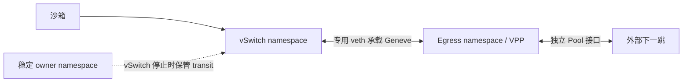

[English](egress.md) | [简体中文](egress_zh.md)

# Geneve Egress 运维与控制合同

Egress 是 IPv4 Geneve 网关，提供有序 ACL、DNAT、按最长前缀选择 Pool 和原生 NAT44-ED。本地与远端部署使用相同的配置及会话 API，不提供 DNS/域名策略、应用代理、IPv6 转发或自动切换 Pool。[提案 #117](https://github.com/kuasar-sandbox/connector/issues/117) 取代原 #9 提案。

控制程序包含 `egress` 命令，VPP 运行时需要单独原生构建。部署前请完成[构建与验收](../egress/README_zh.md)，配套使用固定版本的运行时与插件。交给网关的 Linux 接口专用于其数据面：IPv4 地址由 VPP 持有，Linux 接口保持 administratively up，但不能保留 IPv4 地址。AF_PACKET 后端通过内核 API 关闭并核验 checksum/segmentation offload。

## 本地接线



从 [link.json](../dist/egress/link.json)、[switch.json](../dist/egress/switch.json) 和 [gateway.json](../dist/egress/gateway.json) 开始，按实际 underlay 和出口资源替换示例地址。网关示例的运行库目录为 `x86_64-linux-gnu`，ARM64 应改为 `aarch64-linux-gnu`。

1. 执行 `connector-ctl egress link prepare --config link.json` 创建受管理 pair。缺失的 owner 和 gateway namespace 会被创建并登记身份，已有 namespace 则作为借用资源。transit 端保持 down，留在稳定 owner namespace；gateway 端留在网关 namespace。
2. 由外部网络资源所有者将 `egress-uplink` 放入 `egress-local`，设置与配置一致的 MTU 并启用接口，使外部下一跳具备到 SNAT 地址的真实回程。transit pair 不会将宿主默认路由变成 Egress 出口。
3. 按 [vSwitch 运维](vswitch-operations_zh.md) 准备 switch 和 port namespace，执行 `connector-ctl egress validate --config gateway.json` 校验网关配置。
4. 执行 `ip netns exec egress-local connector-ctl egress serve --config gateway.json`。使用 systemd 时，安装 [connector-egress@.service](../dist/connector-egress@.service)，将配置放在 `/etc/connector-egress/egress-local.json`，启动 `connector-egress@egress-local.service`。示例的持久运行目录与 unit 的 `StateDirectory` 一致。
5. 执行 `connector-ctl egress link start --config link.json --switch-config switch.json --mode veth`。与 `vswitch start` 一致，CLI 默认模式为 `tap`，应按控制方需求选择。管理流程在登记的 owner namespace 内启动 vSwitch，使 transit 端的移入和归还具有确定语义。
6. 使用现有 vSwitch API 接入沙箱，再登记 Egress 会话。通过每个必需 Pool 验证真实请求和回包后，才将沙箱标为可用。

重复执行 `link prepare` 会核对归属并复用 pair；同名外部设备、namespace 身份变化以及已安装 pair 损坏都会被拒绝。每个本地 vSwitch 接入需要独立 pair。多个 pair 可以共用网关 namespace 和运行目录，但各自使用独立 link 配置及归属目录。各 transit 接口拥有独立路由表，外层地址重叠时也保持隔离。

## 远端接线

外部所有者管理的 transit 设备不使用本地 pair 管理流程。在实际网卡所在 namespace 运行相同网关服务。attachment 的 `peer` 是 vSwitch 的外层源地址；经过路由器到达时，将 `next_hop` 设置为 on-link 路由器。直连时默认使用 `peer`。vSwitch 的 transit 地址、下一跳和网关目的地址按现有方式配置，无需修改 Guest 或使用另一套策略 API。

接收接口、本地 VTEP 地址和 peer 地址共同定义受信任接入。Geneve 和 generation MAC 不提供密码学认证，underlay 必须阻止未授权发送方冒用这些接入身份。管理 API 使用私有 Unix socket，不开放未认证网络 listener。远端控制方可通过已有认证通道执行 `egress request`。

## 配置

网关配置采用严格 JSON，拒绝未知字段、重复成员、额外尾随值及超过 4 MiB 的文档。路径和标识符在构造原生命令之前校验。部署文件定义接口、出口、接入 profile 和初始 Area。

| 对象 | 合同 |
|---|---|
| Interface | Linux 名称、由 VPP 持有的 IPv4 `address` 前缀，以及 Linux L3 `mtu`。Linux 接口不能保留 IPv4 地址。 |
| Exit | 独立接口、不同于本地地址的 on-link `next_hop`，以及 1–256 个唯一 SNAT `addresses`。SNAT 资源必须具备外部可达性。 |
| Attachment | 名称、transit 接口、peer、逻辑 `area`、locator/profile、内层网关地址及 fencing 位宽。`inner_mtu` 默认 1500，须匹配沙箱网络。可选 `mtu` 表示外层路径 MTU，不能超过接口 MTU。 |
| Area | 逻辑 `vni`、Pools、有序 `acl`、有序 `dnat` 和按最长前缀匹配的 `routes`。 |
| Pool | Area 内唯一的 0–63 `id`、出口、该出口 SNAT 地址的子集，以及单会话 `max_connections`。零表示没有业务额度限制。 |
| Match | 规范化 IPv4 `destination` 前缀；`protocol` 为 `any`、`icmp`、`tcp` 或 `udp`。非零 `port_first`/`port_last` 只用于 TCP/UDP。 |
| 网关容量 | 最多 4096 个驻留会话，包含正在回收的会话；最多 256 个 Area/attachment/interface 和 64 个出口。网关级 `max_connections` 配置原生 NAT **每个 worker** 的会话容量，默认 65536、最大 1048576，与 Pool 的业务额度分别管理。 |

`workers` 可显式选择 worker CPU ID，`main_core` 选择主线程 CPU；这些 ID 必须互不重复且对进程可用。未配置 workers 时，VPP 使用单线程配置。运行时保留 2 GiB 主堆与 64 MiB 统计段，实际驻留内存随负载变化。

ACL 匹配原始目的地址，按 first-match 顺序执行，默认拒绝。DNAT 在 ACL 之后执行，自行选择 Pool；`target_port=0` 表示保留原端口。普通流量按最长前缀路由，重复前缀会被拒绝。未命中策略、资源耗尽或所选出口不可用时连接失败，不回退到其他 Pool。原生 NAT 处理 TCP/UDP、ICMP echo 及连接相关 ICMP 错误；受管理接入上的其他 IP 协议被拒绝。

回程封装使用外层路径预算与 `inner_mtu` 加 Geneve 开销两者中的较小值。须协调 vSwitch port/transit MTU 与实际 underlay 路径；外层隧道不自动发现路径 MTU。外层分片被拒绝，内层分片、重组和原生 ICMP 错误保留已授权会话身份。

## 既有 Geneve 格式与代次

| Locator | 与 vSwitch 一致的配置 |
|---|---|
| `port` | 默认 `port_base=50000`，目的 UDP 端口为 base 加零起始 slot。4096 端口范围必须有效且不能覆盖 6081。逻辑 VNI 为 24 位。 |
| `vni` | UDP 6081，wire VNI 为 `(slot << 12) | area`，逻辑 Area 必须位于 12 位范围内。 |
| `tlv` | UDP 6081，显式 `tlv_class`/`tlv_type` 须匹配首个 locator option。逻辑 VNI 为 24 位。未知 critical option 被拒绝；非 critical opaque 元数据允许接收，但不在回包中反射。 |

`encapsulation` 为 `ether` 或 `ip`。Ether 且 `generation_bits` 为 1–20 时，自动将既有 generation 编码成源 MAC `02:fe:<32 位 generation>`，generation 零仍然有效。网关将回程 MAC 固定在不可变会话中，不按 slot 当前使用者重新生成。vSwitch 拒绝其他代次的带标记回包，并保留未标记 legacy 回包的既有行为；交付 Guest 前恢复其实际 MAC。

fencing 位宽为零或使用 IP 封装时，Egress 会话的有效 generation 为零，不创造新的 wire 身份。复用该身份前必须撤销并完全回收上一会话；既有无代次协议无法区分复用之后任意迟到的报文。代次分配、位宽、回绕和重启边界沿用 [vSwitch](vswitch_zh.md) 合同，不增加 Attach 参数。

## 会话 API

服务在私有运行目录创建权限为 0600 的 `control.sock`，请求和响应均为 JSON。`connector-ctl egress request <path> --socket <control.sock> --method <method> --file request.json` 调用该 API，`--file -` 从 stdin 读取。Go 包提供相同请求辅助函数与管理引擎。

| 方法/路径 | 请求与行为 |
|---|---|
| `GET /v1/status` | 已配置数据面、Linux 接口状态、接入 profile、原生会话、Pool 计数和 Pool 路径解析状态。 |
| `POST /v1/sessions` | `id`、`attachment`、零起始 `slot`、有效 `generation`、`inner_ip`、`return_mac`、`lease_seconds`（1–300）。返回 token、原生 table 和到期时间。 |
| `POST /v1/sessions/{id}/renew` | `token`、`lease_seconds`。已到期或正在回收的租约不能复活。 |
| `DELETE /v1/sessions/{id}` | `token`。先撤销接收权限，再回收 NAT、额度、接口与重组状态。已不存在的 ID 可安全幂等重试。 |
| `PUT /v1/areas/{vni}` | 同一 VNI 的完整替换 Area，只能在线更新部署中已存在的 Area。 |

例如，成功 Attach 返回 slot 0、generation 1 后：

```json
{"id":"sandbox-a-incarnation-1","attachment":"sw0-area7","slot":0,"generation":1,"inner_ip":"10.7.0.2","return_mac":"02:00:00:00:80:01","lease_seconds":60}
```

必须消费真实 Attach 结果；CLI port 从 1 起始，与零起始 slot 不同。未启用 fencing 的 Ether 接入应使用实际返回的 port MAC。控制方须保管 token，在到期前留出余量续期，在 Detach/删除/复用前撤销，并在复用无代次身份前等待回收完成。相同有效 ID 和登记内容的重试幂等；不同登记、正在回收的 ID 或旧 token 不能替换有效授权。报文不能登记或续期，因此控制方失联后，即使没有 Detach，也会在有界租约内撤销授权。

## 策略更新与重启

Area 更新先校验并暂存完整候选，再在 worker barrier 内提交。ACL 授权、Pool、SNAT 地址、DNAT 目标及实际出口路径均未改变的连接保留原有公网元组。撤销授权或改变资源会终止受影响 mapping，不原地迁移。降低 Pool 额度保留仍获授权的既有 mapping，在用量降至新上限以下前拒绝新建。每沙箱每 Pool 独立计数，内层地址重叠或来自不同受信任 peer 时仍保持隔离。

成功更新会原子持久化为运行目录内的 `policy.json`。需要跨宿主重启保留更新时，应将该目录放在持久存储中。使用相同规范化部署文件重启进程，会恢复已提交策略；显式修改部署文件则选择新的初始策略。数据面重启后不恢复 NAT mapping 或会话授权，控制方必须重新登记当前 Attach 结果。

暂存失败保留上一完整策略。原生提交/登记结果不确定，或已提交策略无法持久化时，supervisor 会停止数据面，不声称回滚或成功。VPP 崩溃会使服务退出，服务管理方可复用 Linux 端点重启。已配置端点丢失或被替换也会停止数据面，不采纳同名替换设备。

## 状态、恢复与卸载

`egress link check --config link.json` 报告归属、pair 完整性、端点位置、活动端口数和 vSwitch conditions。`GET /v1/status` 分别报告接口管理/载波状态、原生转发计数、路由可用性和邻居解析结果。接口 UP 或邻居已解析均不能证明完整就绪，必须通过每个所选 Pool 验证真实沙箱请求及回包；`readiness` 字段明确提示仍需此项探测。

本地接线损坏时：

1. 停止 Egress 服务，撤销并停止使用受影响会话。共享网关重启会丢失该网关全部 NAT 状态。
2. 通过正常沙箱 Detach 排空 vSwitch 已分配端口。`link repair` 拒绝活动端口，不强制删除沙箱。
3. 执行 `egress link repair --config link.json --switch-config switch.json --mode <tap|veth>`。它验证归属、保留/释放端口、停止旧 switch、重建拥有的 pair 或缺失的自有 namespace，再用新设备身份启动 vSwitch。
4. 重启 Egress，重新接入沙箱、登记新授权并验证真实流量后恢复使用。借用 namespace 缺失/被替换，或发现外部设备时，需要相应所有者处理。

普通 `link stop` 拒绝活动端口，将 transit 端归还稳定 owner，不删除 pair。卸载时先撤销会话、Detach 沙箱、停止 vSwitch 和 Egress，再执行 `egress link uninstall --config link.json`。它只删除自有 pair，保留借用 namespace 和外部 Pool 设备。自有 namespace 若仍有进程或其他接口，清理会报告原因并保留归属状态供重试；应由资源所有者释放这些资源后重试。空闲自有 namespace 会被删除，重复卸载安全。首次部署失败会回收本次创建且未使用的 namespace。

控制 socket 和原生 CLI 属于部署所有者。部署文件中的拓扑、接口归属、Area 集合或 attachment profile 变化须显式重启并重新登记；只有既有 Area 的策略使用在线替换 API。
